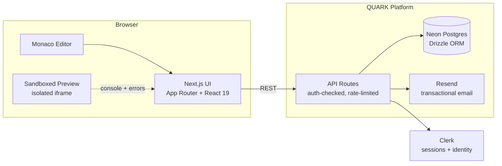
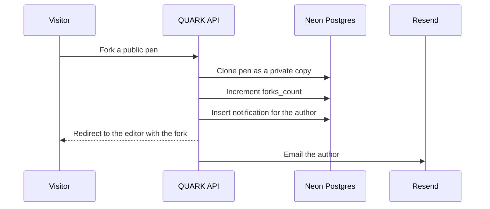
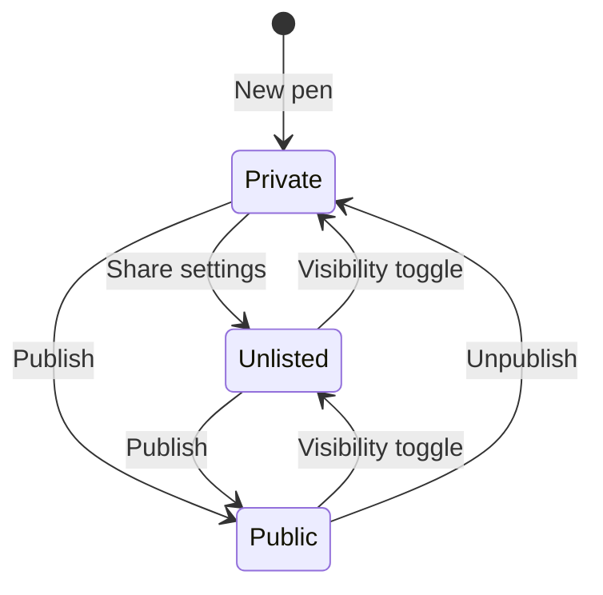

  

<h1 align="center">QUARK</h1>

  <strong>Explain it to the duck. Ship it to the web.</strong> 
  The browser-based frontend playground where ideas become shareable, forkable, embeddable pens.

  
  
  

---

## What is QUARK?

QUARK is a full frontend playground in the browser. Write HTML, CSS, and JavaScript side by side in a Monaco-powered editor, watch a live sandboxed preview update as you type, then publish with one click — your pen gets a shareable page, an embed snippet, SEO-ready social cards, and a home on your public profile.

Fork anyone's public pen into your own workspace, leave comments, report abuse, and build on what the community ships. It's CodePen-like, but the whole loop — edit → publish → discover → fork → notify — runs on one platform.

## Capabilities

- **Monaco editor** — IntelliSense, autocomplete, and syntax highlighting, dynamically loaded to keep the bundle lean
- **Instant sandboxed preview** — executes in an isolated `iframe` (`allow-scripts`, never `allow-same-origin`), with device toggles for desktop, tablet, and mobile
- **Live console bridge** — `console.log/warn/error` and uncaught runtime errors stream from the sandbox into a filterable console drawer
- **One-click publishing** — private, unlisted (link-only), or public; publish limit enforced server-side per plan
- **Pen settings** — name, description, and tags that power explore search and discovery
- **Social-ready share pages** — server-rendered metadata so links unfurl with the pen title, author, and description on Twitter, Slack, Discord, and iMessage
- **Forking** — duplicate any public pen into your workspace; the original author gets an in-app notification and an email
- **Comments & reports** — discussion on every public pen, with moderation tooling behind it
- **Profiles** — every author has a public `/u/username` portfolio of their pens
- **Explore** — search, recent/trending sort, and clickable tag filters with shareable URLs
- **Notifications** — unread-badge bell in the app header and editor, driven by real fork and comment events
- **Admin console** — user moderation, pen takedowns, report queue, and platform settings
- **Abuse protection** — Postgres-backed rate limits on comments, reports, and forks; Clerk session auth on every mutating route

## Visual Tour

### Editor
Monaco editor, live iframe preview, device toggles, and the console drawer.

### Landing
Product landing built on the QUARK design system.

### Explore
Discover, search, tag-filter, and fork public pens.

### Dashboard
Manage pens, visibility, and plan limits in one workspace.

### Public Pen Pages
Shareable, commentable, forkable — with rich social cards.

### Admin Console
Moderation, reports, and platform analytics.

## How It Works

### Architecture

### The fork loop

Every fork is a real event: a new pen, a counter bump, an in-app notification, and an email to the author — all written server-side in one request.

### Pen lifecycle

## Built With

| Layer | Choice |
| --- | --- |
| Framework | Next.js 16 (App Router) + TypeScript |
| UI | React 19, Tailwind CSS v4, custom design tokens |
| Editor | Monaco (`@monaco-editor/react`, lazy-loaded) |
| State | Zustand |
| Database | Neon Serverless Postgres + Drizzle ORM |
| Auth | Clerk |
| Email | Resend |
| Tests | Vitest (live-DB integration suites) |
| CI | GitHub Actions — lint, build, test, secret scan, audit |

## Trust & Safety

- **Sandboxed execution** — preview code runs in an iframe without `allow-same-origin`; host cookies and tokens are unreachable from user code
- **Server-side authorization** — every mutating route verifies the Clerk session and scopes writes to the owning user; nothing trusts the client
- **Rate limiting** — fixed-window counters in Postgres hold across serverless instances (10 comments/min, 5 reports/10 min, 10 forks/hour)
- **Automated pipelines** — CI runs lint, production build, and integration tests; a separate DevSecOps workflow typechecks, scans for leaked secrets, and audits dependencies

## Design System

QUARK is a **neo-brutalist dark** product: sharp lines, high contrast, zero decoration without a job.

- **Canvas** `--void` `#0A0A0A` · **Surfaces** `#1A1A1A` / `#141414`
- **Ink** `#FFFFFF` / `#8A8A8F` / `#55555A` · **Lines** `#2A2A2E`
- **Accent** Quark Blue `#4D8DFF` · **Live** Quark Green `#3ECF8E` · **Danger** Quark Red `#FF4545`
- **Type** Space Grotesk for UI, JetBrains Mono for code — 3px radii, 0.75px dividers

## Roadmap

- **Subscriptions** — Stripe-backed Pro plans with real checkout and webhooks
- **Version history** — time-travel on saved pens
- **Team workspaces** — shared pens and org profiles

## Contributing

We'd love your pull requests. Read [CONTRIBUTING.md](CONTRIBUTING.md) for the workflow, branch naming, and code standards — including how to run the project locally.

## License

[Apache-2.0](LICENSE) © The Pale Architects
